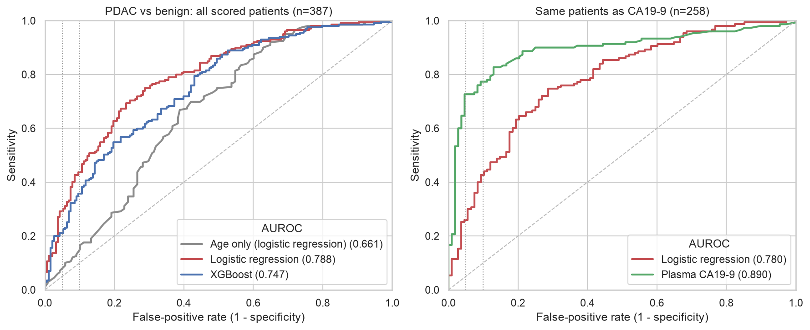
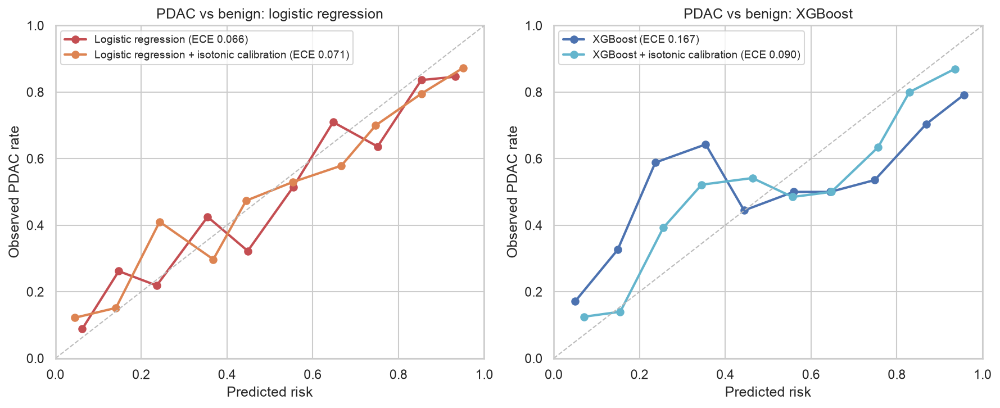

# PancreaSignal

Biomarker-based risk triage for pancreatic ductal adenocarcinoma (PDAC): calibrated per-test models
(urine panel, serum miRNA) wrapped in an agentic pipeline: lab-report intake, guideline RAG,
confounder critic, human review. Every number comes from a reproducible eval harness.

> Research prototype. Not a medical device. Not for clinical use.

## Quickstart (Mac, venv + pip)

```bash
python3.12 -m venv .venv && source .venv/bin/activate
pip install -e ".[dev,notebook,tracking]"
python scripts/download_data.py --only urine   # needs ~/.kaggle/kaggle.json
python scripts/download_data.py --only mirna_gse59856
pytest                                         # all tests should pass
python -m pancreasignal.train --task pdac_vs_benign
python -m pancreasignal.train --config configs/mirna.yaml --task pdac_vs_control
python scripts/make_results.py                 # rebuild RESULTS.md + the tables below
```

## Layout

```
configs/            experiment configs (change values here, not in code)
scripts/            data download, make_results.py (RESULTS.md + tables from reports/)
notebooks/          01 EDA, 02 urine results, 03 serum miRNA: logic lives in src/
docs/figures/       plots used in this README
src/pancreasignal/
  data/             loading + validation: urine.py (Kaggle), geo.py (GEO miRNA)
  features.py       feature engineering
  models/           sklearn Pipelines (leak-safe), incl. elastic-net for p >> n
  evaluation/       splits (leave-one-center-out) + clinical metrics
  train.py          experiment runner -> reports/ (+ MLflow)
  reporting.py      read runs back from reports/
  explain.py        SHAP, coefficients, miRNA selection stability, batch checks
  api/  agents/     Phase 6+
tests/              unit tests = definition of done
```

## Results

<!-- RESULTS:START -->

Pooled out-of-fold AUROC (95% CI). Full tables and caveats: [RESULTS.md](RESULTS.md).

| Model | PDAC vs control* | PDAC vs benign | PDAC vs rest |
|---|---|---|---|
| Age only (logistic regression) | 0.736 (0.686–0.786) | 0.661 (0.610–0.717) | 0.512 (0.462–0.560) |
| Logistic regression | 0.929 (0.902–0.952) | 0.788 (0.742–0.831) | 0.785 (0.745–0.823) |
| XGBoost | 0.929 (0.904–0.951) | 0.747 (0.697–0.792) | 0.744 (0.704–0.782) |

\* Random 5-fold: all controls come from BPTB, so this task cannot be tested on an unseen hospital. The other two tasks are leave-one-center-out.

Age only looks weak when pooled because each hospital has a different PDAC rate; inside each hospital it ranks patients with AUROC 0.70–0.80. The biomarkers beat it at BPTB but not at LIV.

On the same patients, plasma CA19-9 is better: PDAC vs benign AUROC 0.890 vs 0.780 for the urine model.





### Serum miRNA (GSE59856, Phase 5)

| Model | PDAC vs control | PDAC vs biliary tract cancer | PDAC vs benign |
|---|---|---|---|
| Age + sex only (miRNA cohort) | 0.723 (0.645–0.794) | 0.498 (0.417–0.582) | 0.582 (0.439–0.725) |
| Elastic-net on serum miRNA | 1.000 (1.000–1.000) | 0.520 (0.444–0.603) | 0.999 (0.995–1.000) |

Near-perfect scores appear only where the two groups were likely collected separately; pancreatic vs biliary cancer is at chance. Read this as a batch-effect warning, not a better test ([RESULTS.md](RESULTS.md) section 8, [notebook](notebooks/03_mirna.ipynb)).
<!-- RESULTS:END -->

**Model card:** [MODEL_CARD.md](MODEL_CARD.md) (intended use, data, limitations).

## Data

Debernardi et al., *PLOS Medicine* 2020, urinary biomarker panel (via Kaggle). See `data/manifest.json` for exact file hashes.
